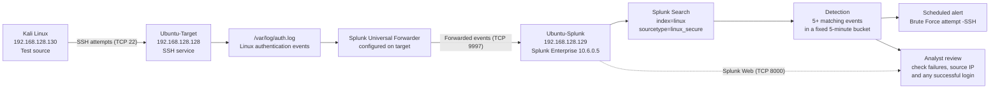

# Lab Architecture

## Overview

I built this lab with three virtual machines in VMware Workstation. Kali Linux generates the test traffic, Ubuntu-Target receives the SSH attempts and writes authentication messages to its local log, and Ubuntu-Splunk collects those messages so I can search them and detect repeated failures.

The addresses below are the ones shown in my screenshots. They are private lab addresses and may change if I rebuild the virtual network.

## Architecture diagram

## What each component does

| Component | Address / port | Role in the lab |
|---|---|---|
| Kali Linux | `192.168.128.130` | Generates repeated SSH login attempts for testing. |
| Ubuntu-Target | `192.168.128.128`, SSH TCP 22 | Receives the attempts and records authentication outcomes in `/var/log/auth.log`. |
| Splunk Universal Forwarder | Runs on Ubuntu-Target | Sends the target's selected log events to the Splunk receiver. The captured command output showed an active forward to `192.168.128.129:9997`. |
| Ubuntu-Splunk | `192.168.128.129`, TCP 9997 | Receives forwarded events and stores them in the `linux` index with sourcetype `linux_secure`. |
| Splunk Web | TCP 8000 | Provides the browser interface for searching events and configuring the alert. |
| Detection search | `linux` / `linux_secure` | Filters for failed-password or invalid-user messages, extracts the IPv4 source address, groups events into fixed five-minute buckets and returns buckets with at least five matches. |
| Scheduled alert | `Brute Force attempt -SSH` | Runs the saved detection search on a schedule. The configuration screenshots document the settings; a trigger/history screenshot is separate evidence of an alert firing. |

## Event flow

1. **Generate activity.** I used Kali Linux to send SSH login attempts to my own Ubuntu target VM.
2. **Record authentication outcomes.** The SSH service on Ubuntu-Target records successful and unsuccessful authentication messages in `/var/log/auth.log`.
3. **Forward the logs.** The configured Splunk Universal Forwarder sends log events to the Splunk receiver on Ubuntu-Splunk over TCP 9997.
4. **Search the events.** In Splunk, I searched the `linux` index and `linux_secure` sourcetype to confirm events were arriving and to find failed authentication messages.
5. **Detect repeated failures.** The SPL query extracts an IPv4 source address, groups matching events into fixed five-minute buckets and filters for counts of five or more.
6. **Investigate the result.** I reviewed the source address and also searched for an `Accepted password` event. That event needs to be interpreted using its timestamp and the target's local log; by itself, it does not prove a compromise.
7. **Configure an alert.** I configured a scheduled alert for the detection. The alert settings and evidence that it actually triggered should be treated as two different things.

## Network and security notes

- These IP addresses are private addresses used inside the VMware lab, not public attacker addresses.
- TCP 8000 is used to access Splunk Web; TCP 9997 is the configured receiving port for forwarded logs; TCP 22 is used for SSH testing.
- The diagram describes the lab design and observed configuration. It is not a packet capture and does not independently prove every connection or alert action.
- The detection groups events into fixed five-minute buckets. It is not a rolling five-minute window, and the current source-IP extraction expression supports IPv4 only.
- The testing was performed against my own lab systems. No production system was targeted.
